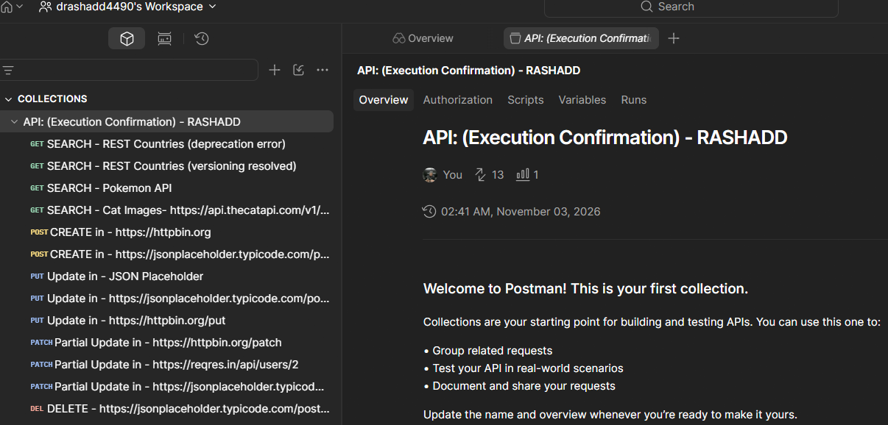

# REST-API-Postman-execution
Executed full REST API testing in Postman across GET, POST, PUT, PATCH, and DELETE using JSONPlaceholder, HTTPBin, and ReqRes. Resolved version deprecation issues with REST Countries v5 and fixed JSON syntax errors. Exported collection v2.1 with a custom README.md in VS Code, authenticated Git, and pushed the suite live to GitHub.

**What is Covered**

* **Full CRUD Lifecycle Execution:** I constructed and executed requests across all primary HTTP methods—`GET` (read/fetch), `POST` (create), `PUT` (full replace), `PATCH` (partial update), and `DELETE` (remove)—using testing endpoints from JSONPlaceholder, HTTPBin, ReqRes, Restful-API Dev, and PokeAPI.
* **Request & Payload Formatting:** I handled structured JSON bodies, key-value query parameters, and custom request headers (`Authorization: Bearer ...`).
* **Postman Collection Organization:** I organized individual endpoints into a structured collection (`API: (Execution Confirmation) - RASHADD`), asserting status codes like `200 OK` and `201 Created`.
* **Portfolio Documentation & Version Control:** I exported the collection as a `v2.1` JSON file, created a structured `README.md` in VS Code, authenticated VS Code with GitHub, and pushed the complete project to a public repository via Git commands (`git init`, `add`, `commit`, `branch`, `remote`, `push`).

**Challenges I Encountered & Resolved**

1. **API Versioning & Deprecation Breaking Changes:**
* *Challenge:* When I queried legacy endpoints like `[https://restcountries.com/v3.1/all](https://restcountries.com/v3.1/all)` or `[https://restcountries.com/v5/all](https://restcountries.com/v5/all)`, I received JSON errors stating older public versions were deprecated.

* *Resolution:* I analyzed the official documentation to identify three breaking structural changes in version 5—switching to a dedicated subdomain (`api.restcountries.com`), updating the base route (`/countries/v5`), and providing a demo bearer token / API key (`?api-key=rc_live_demo`).

2. **JSON Payload Syntax Errors:**
* *Challenge:* I encountered malformed JSON errors during `PATCH` request formatting due to missing commas between key-value pairs (`"action": "..." "updated": true`).
* *Resolution:* I corrected the syntax by separating parameters with commas to satisfy valid JSON formatting specifications before sending the payload.

3. **Postman UI & Export Navigation:**
* *Challenge:* I had to navigate Postman’s multi-nested menu UI to locate the local JSON file export option, which triggered an optional user feedback prompt ("Tell us about this export").
* *Resolution:* I bypassed the feedback step by selecting **Start Export**, specifying **Collection v2.1 (recommended)**, and saving the file directly into my local project directory.

4. **Environment Setup & Version Control Workflow:**
* *Challenge:* I needed to ensure unsaved files (indicated by the white dot in VS Code) were saved so Git could detect them, while also authenticating VS Code with GitHub for terminal execution.
* *Resolution:* I saved `README.md` using keyboard shortcuts (`Ctrl+S`), authenticated GitHub/VS Code via browser authorization, and executed terminal Git commands to link and push my main branch to GitHub.
